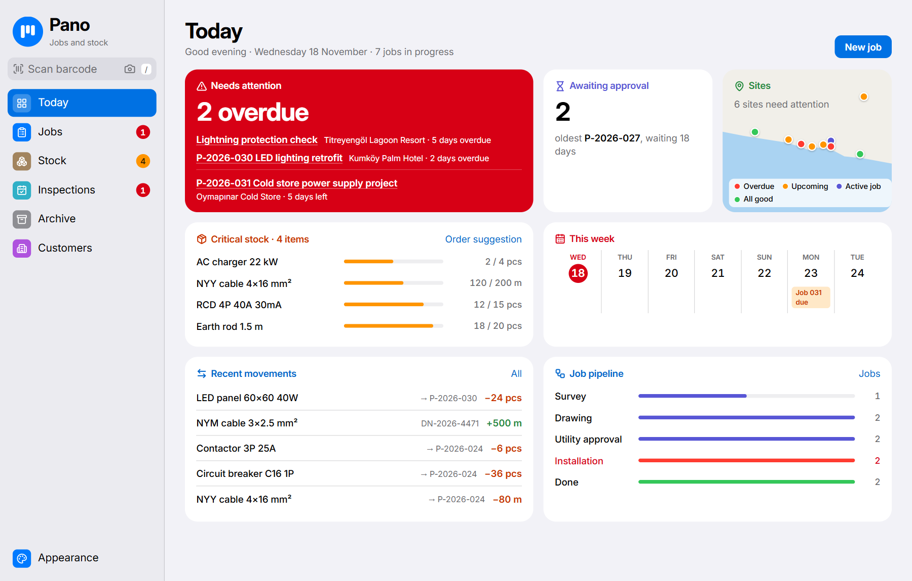
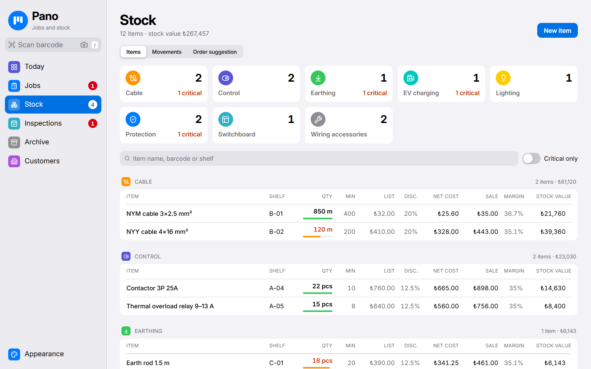
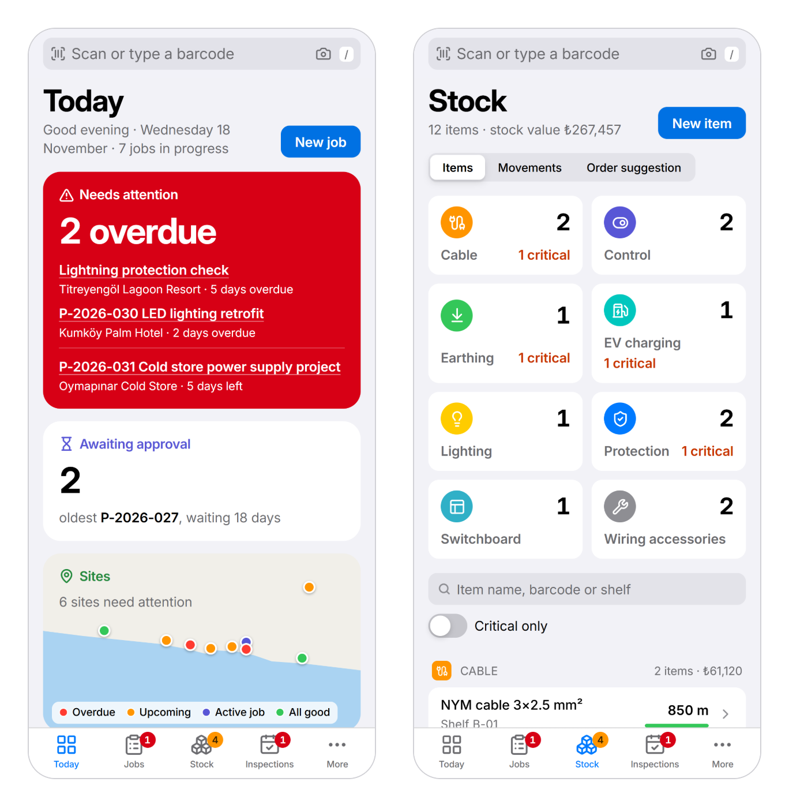

# Pano

**Job, stock and periodic-inspection tracking for small electrical contractors.**

Pano replaces the paper lists, spreadsheets and memory that a small contracting office runs on. It covers jobs moving from site survey to handover, a barcoded warehouse, recurring inspections at customer sites, and drawing revisions. It runs on a single office PC as a Windows service, is used from the office browser, and from phones over a private [Tailscale](https://tailscale.com) network. Nothing is exposed to the internet.




| Stock | Phone |
|---|---|
|  |  |

> The interface is available in Turkish and English. Each browser can switch under **Appearance**, and the `Language` setting picks the default. The screenshots show the English interface with the fictional sample data that development mode seeds.

## Features

- **Today.** Overdue jobs and inspections, jobs waiting for the utility's approval and for how many days, critical stock, the coming week, recent stock movements and the job pipeline on one screen.
- **Jobs.** Grouped by workflow stage (survey → drawing → utility approval → installation → done); click the stage bar to move a job. Job codes are assigned automatically (`P-2026-001`). The job detail shows the materials issued, their cost and sale value, the job's documents and the site's inspections.
- **Stock.** Categories, minimum levels and critical items, list price − discount = net purchase price, sale price, margin and stock value. Also a movement ledger and a seasonal order suggestion based on the last 90 days of consumption.
- **Barcode receiving and issuing.** Type a code, use a USB scanner (it behaves like a keyboard) or the phone camera. A known code opens the receive / issue-to-job panel; an unknown one opens a new-item form with the code filled in. Stock can never go negative.
- **Internal barcodes and shelf labels.** Items without a manufacturer barcode get an EAN-13 code in the GS1 in-store range (prefix `29`), so they never collide with real product codes. Shelf labels are drawn as SVG and printed from the browser.
- **Periodic inspections.** Earthing measurements, generator service, lightning protection and the like; the next date is computed from the last one. "Done today" can be undone.
- **Document archive.** DWG/DXF, PDF and photos attached to jobs. Uploading a file with the same name creates the next revision. Files live on disk, the database keeps the records.
- **Customers.** Sites with a status derived from their jobs and inspections.
- **Daily e-mail digest (optional).** A morning summary of what needs attention, sent over SMTP.
- **UI.** Turkish and English, iOS-style, light and dark themes, seven accent colours, a phone layout with a tab bar, and respect for "reduce motion".

## Tech stack

| Layer | Technology |
|---|---|
| Backend | ASP.NET Core 10 minimal API (C#), EF Core 10 + Npgsql, snake_case tables |
| Database | PostgreSQL 18 |
| Frontend | React 19, React Router 7, Vite, lucide icons, Inter font (bundled) |
| Barcode scanning | Native `BarcodeDetector` where available, otherwise [`barcode-detector`](https://github.com/Sec-ant/barcode-detector) with the zxing-wasm binary bundled, so it works offline |
| Hosting | Windows service on one office PC; phones over Tailscale HTTPS |
| Tests | xUnit |

## Getting started (development)

Prerequisites: [.NET 10 SDK](https://dotnet.microsoft.com/download), [Node.js](https://nodejs.org) 22 or newer, [PostgreSQL 18](https://www.postgresql.org/download/).

**1. PostgreSQL.** Install it and note the password of the `postgres` user. On Windows:

```powershell
winget install --id PostgreSQL.PostgreSQL.18 --exact --override "--mode unattended --unattendedmodeui minimal --superpassword YOUR_PASSWORD --serverport 5432 --locale tr-TR --disable-components stackbuilder"
```

> Pass `--locale` explicitly when the Windows display language is not English. The Turkish locale name, for example, contains a non-ASCII character and makes `initdb` fail with "Failed to initialise the database cluster".

**2. API.** The connection string is kept in user secrets, never in the repository:

```bash
cd backend/Pano.Api
dotnet user-secrets set "ConnectionStrings:Pano" "Host=localhost;Port=5432;Database=pano;Username=postgres;Password=YOUR_PASSWORD"
dotnet run
```

The API listens on `http://localhost:5080`. On first start it creates the `pano` database, applies the migrations and, in Development, seeds fictional sample data. The data is seeded once, in Turkish by default. For English sample data and an English interface, start the very first run with `dotnet run -- --Language=en`.

**3. Frontend.**

```bash
cd frontend
npm install
npm run dev
```

Open `http://localhost:5173`; requests to `/api` are proxied to port 5080. `npm run build` writes the production bundle to `backend/Pano.Api/wwwroot`, where the API serves it.

**4. Tests.**

```bash
cd backend
dotnet test
```

Stop a running `dotnet run` first; otherwise the build fails because the executable is locked.

## Production install (Windows)

The scripts in `deploy/` turn one office PC into the server. Their parameter names are Turkish. A step-by-step guide in Turkish is in [`deploy/KURULUM.md`](deploy/KURULUM.md).

1. **Install PostgreSQL 18** on the office PC (same command as above).
2. **Build the package** on a development machine:
   ```powershell
   .\deploy\publish.ps1
   ```
   This produces `dist\Pano`. It is self-contained, so the office PC needs neither .NET nor Node.
3. **Copy the folder to the office PC** (USB stick, cloud drive, network share). Then run in an elevated PowerShell inside the folder:
   ```powershell
   Get-ChildItem -Recurse | Unblock-File      # only if it was downloaded
   Set-ExecutionPolicy -Scope Process Bypass
   .\kur.ps1 -YedekKlasoru 'E:\PanoBackup'    # backup folder: external disk or synced cloud folder
   ```
   The script:
   - asks once for the `postgres` password and writes it to a settings file that only administrators and SYSTEM can read;
   - installs to `C:\Pano` and registers the **Pano** Windows service (automatic start, restart on failure);
   - schedules a daily backup at 19:00: `pg_dump` plus a copy of the document archive, kept for 30 days;
   - checks that the app answers on `http://localhost:5080`.
4. **Update** by running the same two steps again (`publish.ps1`, then `kur.ps1`). The database, archive, settings and backup folder are kept.
5. **Phones.** Install Tailscale on the office PC and the phones, then run `tailscale serve --bg 5080` on the PC and open the `https://<machine>.<tailnet>.ts.net` address on the phone. The camera scanner needs this HTTPS address (on the office PC itself, `localhost` also counts as secure).
6. **Restore** a backup:
   ```powershell
   & 'C:\Program Files\PostgreSQL\18\bin\pg_restore.exe' -h localhost -U postgres -d pano --clean --if-exists 'E:\PanoBackup\pano-<date>.dump'
   ```
   Then copy the backed-up archive folder back to `C:\PanoVeri\arsiv`.

### E-mail digest (optional)

Every morning the service mails one summary: overdue jobs and jobs due within 7 days, jobs waiting for approval, overdue inspections and those due within 30 days, and critical stock. Nothing is sent on a quiet day, and never twice on the same day. Enable it at install time or later:

```powershell
.\kur.ps1 -EpostaAlici 'owner@example.com' -SmtpKullanici 'sender@gmail.com'
```

`-EpostaAlici` is the recipient (comma-separate several) and `-SmtpKullanici` is the sending account. The script asks for the SMTP password and sends a test mail. With Gmail, use an [app password](https://support.google.com/accounts/answer/185833). `SmtpClient` supports STARTTLS on port 587, not implicit TLS on 465. To resend the test mail:

```powershell
Invoke-RestMethod -Method Post http://localhost:5080/api/notify/test -Headers @{ 'X-Pano' = '1' }
```

### Branding

The repository ships a neutral logo. To use your own, put `logo.svg` (round, shown at 48 px and used as favicon) and `apple-touch-icon.png` (180 × 180) in `deploy/brand/`. The folder is git-ignored, and `publish.ps1` copies its files over the defaults when it builds the package.

## Configuration

Settings come from `appsettings.json`, the production file `appsettings.Production.json` written by `kur.ps1`, user secrets in development, or environment variables (`ConnectionStrings__Pano`, `Email__Host`, …).

| Key | Default | Meaning |
|---|---|---|
| `ConnectionStrings:Pano` | – | PostgreSQL connection string |
| `Urls` | `http://localhost:5080` | Listening address; local only by design |
| `Language` | `tr` | `tr` or `en`. The default interface language, and the language of the seeded workflow stages, inspection types and sample data and of the e-mail digest |
| `Archive:Path` | `C:\PanoVeri\arsiv` | Root folder of the document archive |
| `Email:Host` / `Port` / `Ssl` | – / `587` / `true` | SMTP server; the digest is off while `Host` or `To` is empty |
| `Email:User` / `Password` / `From` | – | SMTP account; `From` defaults to `User` |
| `Email:To` | – | Recipients, comma-separated |
| `Email:Hour` | `8` | Hour of day after which the digest is sent |

## Project structure

```text
backend/
  Pano.Api/
    Data/          entities, DbContext, seed data, EF Core migrations
    Endpoints/     one file per module (customers, projects, materials, movements, checks, documents, notify, dashboard)
    Rules.cs       database-independent business rules (unit tested)
    Program.cs     hosting, CSRF guard, static files, Windows service
  Pano.Tests/      xUnit tests for Rules
frontend/
  src/
    pages/         one screen per file
    api.js         fetch wrapper (adds the X-Pano header)
    i18n.js        interface language; en.js holds the English strings
    Kamera.jsx     camera barcode scanner
    styles.css     design tokens and components
deploy/            publish.ps1, kur.ps1, yedek.ps1, KURULUM.md
DESIGN.md          design system notes
```

## API

All routes are under `/api`, return JSON and report errors as RFC 9457 problem details.

| Area | Routes |
|---|---|
| Overview | `GET /settings`, `GET /dashboard` |
| Customers | `GET`, `POST /customers`; `PUT`, `DELETE /customers/{id}` |
| Jobs | `GET`, `POST /projects`; `GET`, `PUT`, `DELETE /projects/{id}`; `PUT /projects/{id}/step` |
| Materials | `GET`, `POST /materials`; `GET`, `PUT`, `DELETE /materials/{id}`; `GET /materials/barcode/{code}` |
| Stock movements | `GET`, `POST /movements` |
| Inspections | `GET`, `POST /checks`; `DELETE /checks/{id}`; `GET /checks/{id}/history`; `POST /checks/{id}/done`; `POST /checks/history/{hid}/undo` |
| Documents | `GET /documents`; `POST /projects/{id}/documents`; `GET /documents/{id}/file`; `DELETE /documents/{id}` |
| E-mail | `GET /notify`, `POST /notify/test` |

## Design decisions

- **Stock changes only through movements.** Editing an item never touches its quantity, and opening stock is recorded as a receipt, so every number can be traced.
- **No negative stock, even with concurrent issues.** An issue is a single `UPDATE … WHERE quantity + delta >= 0` inside a transaction. When no row is updated, the request fails with 409 instead of overselling.
- **Prices are snapshotted.** A movement stores the net purchase and sale price of that moment, so a job's cost does not change when prices are updated later. Job cost is issues minus returns.
- **History is never deleted.** Foreign keys are `Restrict`, and the API answers 409 for records with history. An item can be deleted only if it never moved. For a document, only the latest revision can be deleted, and the file is moved to `_silinenler` rather than erased.
- **Inspection dates are computed, not stored.** The next date comes from the last one, so changing a period updates the schedule at once.
- **CSRF protection without accounts.** Every state-changing `/api` request must carry an `X-Pano` header, which another site cannot send without a CORS preflight.
- **Two languages without a library.** Interface strings are written in Turkish and looked up in an English dictionary, with plural forms as functions. Stored data such as item names and workflow stages is never translated.
- **Offline first.** Fonts and the barcode decoder are bundled, and the server binds to localhost. Remote access goes only through Tailscale.

## Roadmap

- User accounts and roles (access is currently limited at the network level)
- A real map for customer sites (currently a schematic)
- A settings screen for workflow stages and custom job fields
